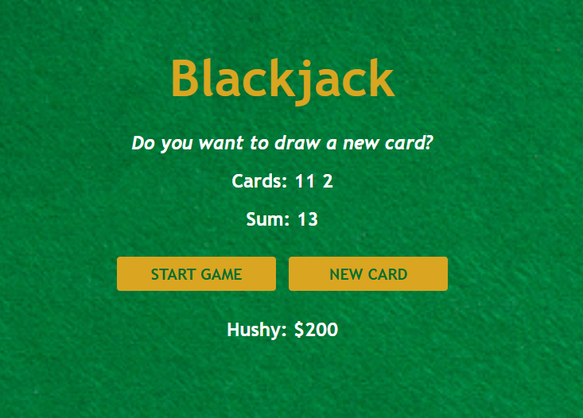

# 🃏 Blackjack

A simple Blackjack game in the browser: draw two cards, ask for more, and try to reach exactly 21 without going over.

Project from the [Scrimba Fullstack Developer Path](https://scrimba.com/fullstack-path-c0fullstack) (*JavaScript Fundamentals* module).

**🌐 Live demo:** [Scrimba Blackjack Game](https://scrimblackjack.netlify.app)



## ✨ Features

- **START GAME** deals two random cards
- **NEW CARD** draws another card, only while you are still in the game and don't have Blackjack
- Card values follow Blackjack rules: J, Q and K are worth 10, the Ace is worth 11
- The dealer's message changes with your total: keep drawing, Blackjack, or out of the game
- Player name and chips displayed under the table

## 🛠️ Built with

- HTML5
- CSS3 (Flexbox)
- Vanilla JavaScript (no framework, no library)

## 🧠 What I practiced

- Conditions with `if`, `else if` and `else`, and strict comparison with `===`
- Booleans to keep track of the game state (`isAlive`, `hasBlackJack`)
- Arrays: storing the cards and adding new ones with `push()`
- `for` loops to render every card, whatever their number
- Functions that `return` a value
- Random numbers with `Math.random()` and `Math.floor()`
- Logical operators (`&&`) to allow a new card only when it makes sense
- Objects to group the player's data (`player.name`, `player.chips`)

## 🚀 Run it locally

```bash
git clone https://github.com/Hushhhy/simpleBlackjackGame.git
cd simpleBlackjackGame
```

Then open `index.html` in your browser. No installation needed.

## 📁 Project structure

```
simpleBlackjackGame/
├── index.html
├── style.css
├── script.js
└── images
    ├── table.png
    └── screenshot.png
```

## 🙏 Credits

- Project brief and design: [Scrimba](https://scrimba.com)
- Built by [Alexis Carpentier](https://github.com/Hushhhy)